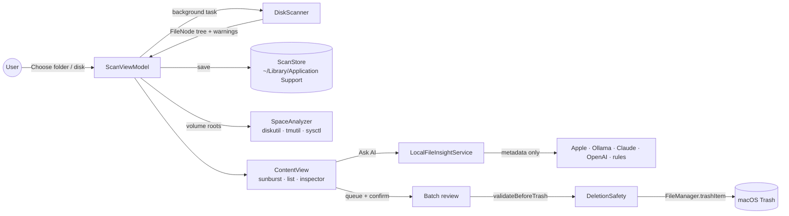
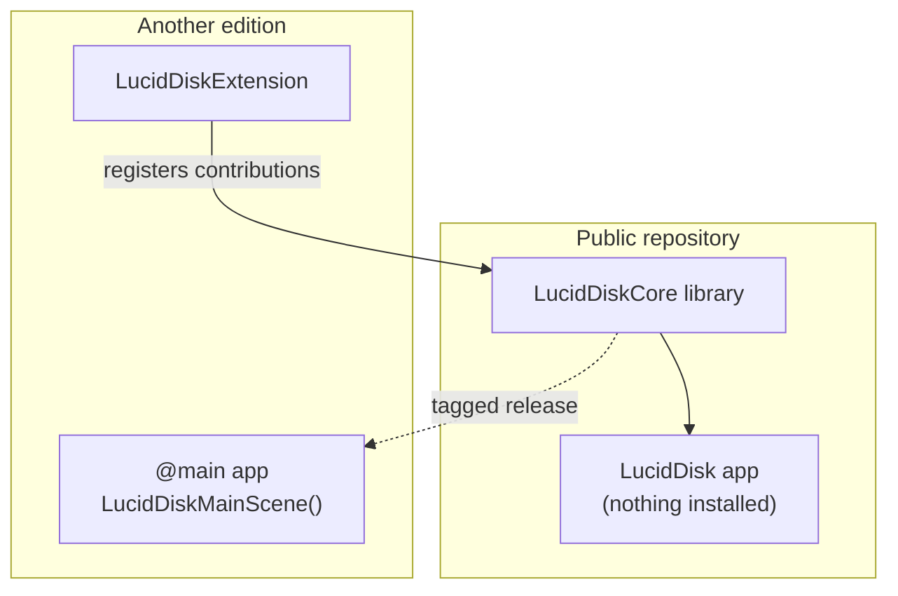

# Architecture

Lucid Disk is a native macOS app written in Swift (SwiftUI with AppKit where performance or native behavior matters). This page explains how the pieces fit together. For the rules every change must keep, read [safety.md](safety.md).

## Repository map

```text
Sources/
  LucidDiskCore/            the whole app, as a library
    App/                    LucidDiskMainScene: window, menus, Settings
    Scanning/               DiskScanner, ScanViewModel, batch review
    Safety/                 DeletionSafety: risk rules and pre-Trash checks
    Persistence/            ScanArchive (binary format), ScanStore (saved scans)
    Space/                  SpaceBreakdown: the "System Data" explainer
    Insight/                Lucid Insight: AI providers and the rule-based fallback
    Sunburst/               chart layout (Wedge) and drawing (SunburstView)
    Views/                  ContentView, inspector, settings, help, theme
    Extensions/             extension points for other editions
    Resources/              Localizable.xcstrings (English and Turkish)
  LucidDisk/                the Community @main app (a few lines)
Tests/                      XCTest suite + shared safety fixture
mcp/                        read-only MCP server (Python)
website/                    landing page (Next.js)
video/                      promo video and store art (Remotion)
Tools/                      icon export, desktop UI review harness
scripts/                    release verification and evidence
```

## Data flow



### Scanning

`DiskScanner` walks a directory tree with one `lstat` per entry, building a `FileNode` tree. It:

- counts hard-linked files once (by device and inode),
- visits each directory identity (device and inode) once, including the root, so directory aliases and cycles cannot inflate progress or totals,
- stays on the root's volume and skips `/System/Volumes`, `/Volumes` and other system mount points, so firmlinked data is not counted twice,
- excludes the root-level macOS resolution aliases `/.nofollow` and `/.resolve` (including explicitly selected descendants); their bare stub inode can differ from the root they expose when enumerated,
- marks unreadable folders and cut-off scans as incomplete instead of hiding them,
- checks for cancellation between entries.

Allocated sizes remain estimates: distinct APFS clones may share physical blocks even after inode deduplication. Progress and space breakdown distinguish this sum from disk usage and reclaimable space; totals are never clamped to capacity to hide a discrepancy. An old scan already affected by alias traversal must be replaced by a fresh scan with the corrected scanner.

`ScanViewModel` (main actor) owns the published state: the tree, focus, selection (`selectedNode` plus `selectedNodes`), the review queue, warnings, saved scans and the space breakdown. Every scan gets a `scanID`; late results from a superseded scan are ignored. User-facing Stop asks the scanner to unwind directory totals and publish a partial tree, marked incomplete. A failed rescan keeps the previous result. A folder rescan replaces only that subtree in a live result; rescanning from a saved snapshot starts a fresh scan rooted at the chosen folder so stale siblings never gain Trash access.

The contents browser supports word matching across names and paths, folder scope, kind, minimum allocated size, extensions and modification date. Details open explicitly below the chart and can be closed without changing selection or shrinking the file list. Home retains the current scan for returning to its results. Capacity labels distinguish total from available space; volume values refresh after scans, on activation and periodically while active.

### Reports and assistant review

`ScanReport` captures an immutable tree revision off the main actor. A result export includes the exact displayed matches plus ancestor context; exporting a folder tree explicitly ignores search filters and includes every scanned descendant. Text keeps a readable hierarchy, while CSV and JSON retain depth, parent paths, types, sizes, dates, accuracy and warnings. The UI preview is bounded, but files are complete. Reports identify saved or partial scans and do not imply that overlapping folder/file sizes are independently reclaimable.

`AssistantReviewBrief` prepares a bounded, metadata-only cleanup prompt from these results. It treats names and paths as untrusted data, reports omitted matches, and asks for read-only checks and a prioritized cleanup plan. The handoff copies the previewed brief and launches an installed Codex or Claude Desktop; it never sends messages automatically. A complete report can be saved and attached by the user. All actual cleanup stays in the existing review/confirmation/validation flow. Every application action has a visible text label, including toolbar overflow items and folder-row actions.

### Saved scans

`ScanArchive` encodes a tree as a compact, LZFSE-compressed preorder stream: names, flags, sizes, dates and identity per node, with paths rebuilt on load. `ScanStore` writes one archive plus a small JSON summary per scan and keeps `retentionPerRoot` scans per location (one in the Community edition). A saved scan opens as a snapshot: it can be browsed and queued, but nothing can be moved to the Trash until a fresh scan.

### Space breakdown

After a volume-root scan, `SpaceAnalyzer` compares the scanned total with what macOS reports. It reads APFS containers and volume roles from `diskutil apfs list -plist`, local snapshots from `tmutil`, swap from `sysctl vm.swapusage` and purgeable space from URL resource values. The result lists other volumes (Preboot, Recovery, VM, Update), used space a scan cannot see, and any excess in the allocation estimate. The capacity bar uses macOS used/free capacity rather than the potentially overlapping file estimates; the raw estimates remain visible in the list. System tools run by absolute path, with a timeout, behind the `SpaceProbe` protocol so tests use fixtures.

### Lucid Insight

Pressing **Ask AI** builds a prompt from the selected item's metadata (never file contents), with names and paths escaped as data. The provider chosen in Settings answers only the "probable purpose" line; risk, summary and recommendation always come from `DeletionSafety`. Providers: Apple Foundation Models, Ollama (local, cloud-hosted models hidden), the Claude API, OpenAI Responses API, or rules only. Each cloud provider has its own Keychain entry and explicit consent; OpenAI requests disable response storage. Any failure falls back to the rule-based explanation, never to another provider.

### Cleanup

Cleanup is always: select → add to the review queue → confirm → `DeletionSafety.validateBeforeTrash` → `FileManager.trashItem`. Batch moves drop items inside another queued folder, exclude protected items, re-validate each item right before its own move, and report what was skipped. After any move the old tree is discarded and the location is rescanned.

## Editions and extension points

The app is a library so another edition can build on it. `LucidDiskExtensions` accepts an edition name and contributions for the sidebar, the inspector and Settings. Extensions receive a `LucidDiskContext` that can read the tree and selection and add items to the review queue, but cannot move anything to the Trash or construct a safety verdict. `ScanStore` is public so an edition can keep a scan history. See [EDITIONS.md](../EDITIONS.md).



## MCP server

`mcp/` is a separate Python package exposing five read-only tools over stdio. Its risk rules mirror `DeletionSafety.swift`; both test suites read `Tests/Fixtures/deletion-safety.json`, so the two implementations cannot drift apart silently. See [mcp/README.md](../mcp/README.md).

## Key decisions

| Decision | Why |
|---|---|
| Trash only, never delete | Every action stays reversible from Finder. |
| Deterministic safety over AI | Models can be wrong or manipulated; rules are testable. |
| Identity re-check before Trash | A file replaced after the scan must not be moved. |
| Allocated size in the chart | It reflects disk usage; logical size is shown alongside. |
| Binary archive for saved scans | Whole-disk trees have millions of nodes; JSON is too slow and large. |
| Native table for file lists | Smooth with tens of thousands of rows. |
| No telemetry | Storage data is personal. |
